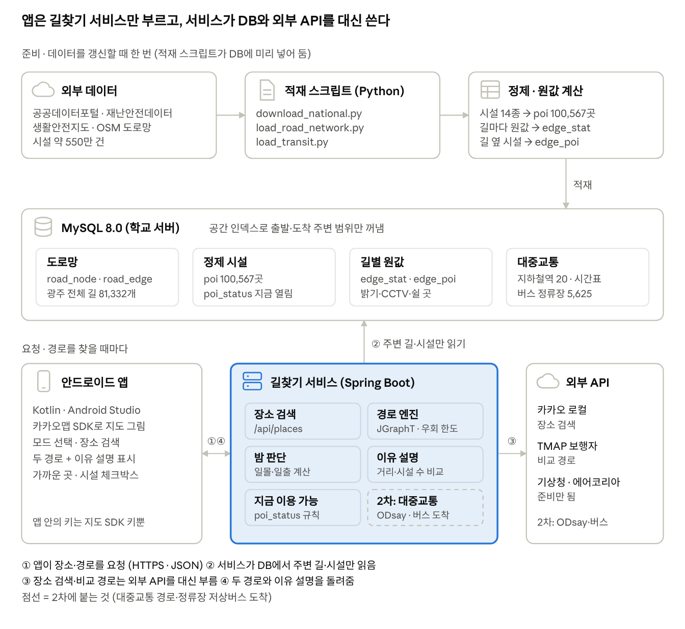
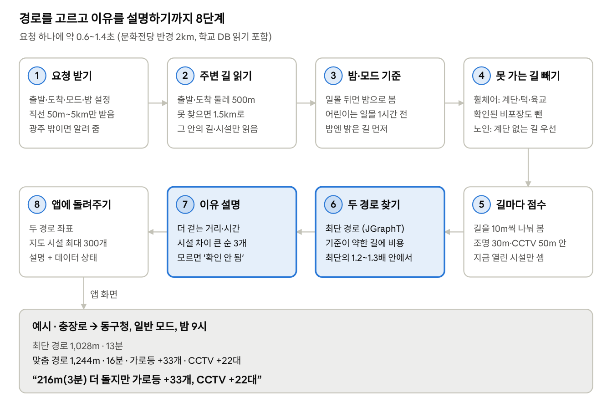
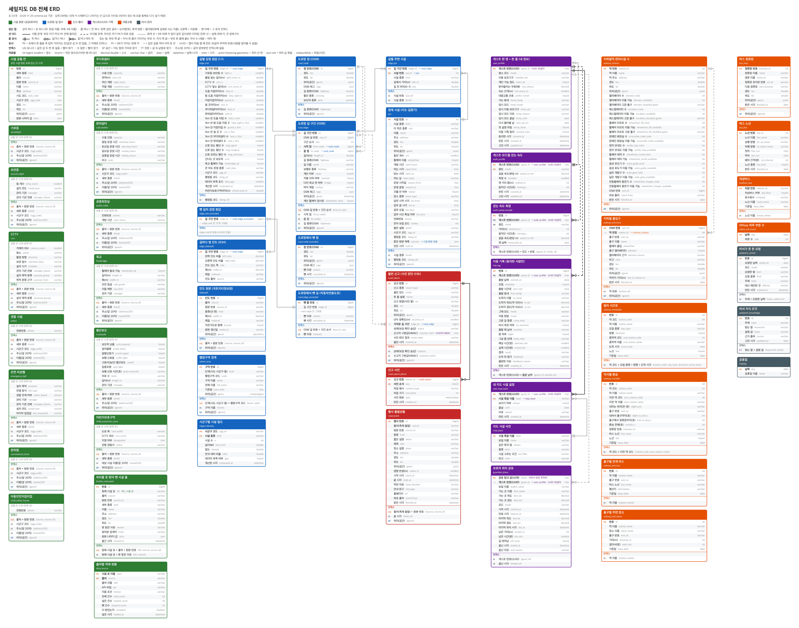
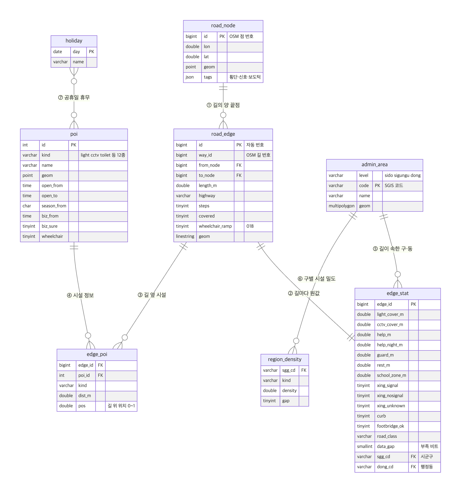

# 🍀 세잎지도 · 2팀

**어린이·노인·장애인과 그 가족에게, 그 사람에게 맞는 길과 왜 그 길인지를 알려 주는 도보 길 안내 앱**

> 이 화면은 Safe-Way 조직 멤버에게만 보입니다. 아래는 [요구사항 분석서 0. 한눈에 보기](https://github.com/Safe-Way/safe-route-docs/blob/develop/requirements/00-overview.md) 그대로이고, 1장부터 끝까지는 맨 아래 목차에 있습니다.
>
> 바로 보기: [팀원과 한 일](#-팀원과-한-일) · [시스템 구조](#시스템-구조) · [ERD](#erd-경로-계산-표) · [AI 사용](#-ai를-어떻게-썼나-숫자로) · [주요 기능](#0-한눈에-보기-우리가-만드는-것) · [처음 시작하기](#처음-시작하기) · [요구사항 목차](#-요구사항-분석서-전체-목차)

## 🎤 발표 자료 (2026 IT Festival)

조선대학교 2026 IT Festival · AI·SW 캡스톤디자인 프로젝트 경진대회 발표에 쓴 자료입니다. 조직 멤버만 내려받을 수 있습니다.

| 자료 | 내용 | 받기 |
| --- | --- | --- |
| 📊 발표 슬라이드 (20장, PPTX 1.2MB) | 왜 만들었나 → 데이터 → 경로 엔진 → 결과 → 앱·AI 비서·길안내 → 시험(사용성 점검·현장 비교) → 협업 → 기대효과 | [세잎지도 발표_최종.pptx](https://github.com/Safe-Way/.github/releases/download/presentation-2026-11/seipjido-presentation.pptx) |
| 🎬 발표 영상 (4분, 1080p MP4 54MB) | 발표 슬라이드를 따라 설명하는 영상 | [세잎지도 발표 영상.mp4](https://github.com/Safe-Way/.github/releases/download/presentation-2026-11/seipjido-presentation-video.mp4) |

<sub>두 파일은 이 저장소의 [릴리스 presentation-2026-11](https://github.com/Safe-Way/.github/releases/tag/presentation-2026-11)에 있습니다.</sub>

---

## 👥 팀원과 한 일

4명이 파트 하나씩 맡았습니다. PR 수는 2026-11-16까지 머지된 기능 PR(배포용 develop → main PR은 뺌)입니다.

| 팀원 | 파트 | 한 일 | PR |
| --- | --- | --- | --- |
| 김재휘 | A 데이터·DB, PO | · 공공데이터 13종 + OSM → 학교 MySQL 적재<br>· 원본 약 550만 건 → 시설 100,659곳 정제<br>· 광주 걷는 길 81,699개에 감점 원값(edge\_stat), 길별 주변 시설 172,675줄(edge\_poi)<br>· 지하 길·광장 가로지르기 선 4,352줄, 인도 60,584줄<br>· 지하철 출구 엘리베이터 92곳 확인 (문화전당역 현장 확인)<br>· 신고 사진 분류 모델 학습 (MobileNetV3, v6)<br>· 요구사항 분석서 (v32, 결정 60건)·진행표 관리<br>· 비서 지식 조각·키워드 표·시험 질문 39개 | 서버 61 · 문서 27 · 앱 2 |
| 정원일 | B 경로 엔진 | · 모드(어린이·성인·노인·휠체어)·낮밤별 안전 경로<br>· 최단 길과 비교한 "왜 이 길인지" 문장<br>· 휠체어: 계단·비포장·인도 없는 골목·좁은 인도 피함<br>· 신고·행사 자리 피하기<br>· 비 오는 날 지붕·지하 길<br>· 들를 곳 3곳까지, 광장 가로지르기, 지하 시설 출구 고르기 | 서버 33 |
| 김채림 | C 서버 API·평가 | · 앱이 부르는 서버 창구 전부: 장소 검색, 길찾기, 날씨·미세먼지, 버스·지하철·대중교통(ODsay), 불편 신고, 내 정보·다닌 기록, 보호자 위치 공유, 오늘 제안<br>· **AI 비서**(/api/assistant)·비서 토큰 줄이기<br>· 신고 사진 차량 판단·저장 (photo\_label)<br>· TMAP 30쌍 비교 평가<br>· 학교 서버 배포 (서버 두 대) | 서버 70 |
| 박민수 | D 안드로이드 앱 | · 카카오맵 지도, 검색·모드 고르기, 두 길 비교 화면<br>· 길안내: 폰 방향 따라 도는 지도, 꺾는 곳 화살표, 작은 창, 이어서 하기<br>· 대중교통 탭<br>· AI 비서 화면·말로 대화<br>· 신고 화면·지도 표시<br>· 처음 설정, 이동 기록 | 앱 142 |

## 시스템 구조



<sub>요구사항 8장의 그림과 같습니다(원본은 요구사항 원본 문서의 그림).</sub>

- **무거운 일은 미리 한 번만 합니다.** 내려받기·정제·길마다 원값 계산은 적재 스크립트가 데이터를 갱신할 때 해서 DB에 넣어 둡니다. 경로를 찾을 때 서버는 DB를 읽어 계산만 합니다.
- **앱은 길찾기 서비스하고만 통신합니다.** 키가 필요한 외부 API는 길찾기 서비스(Spring Boot 서버)가 대신 부르므로 앱에는 키가 들어가지 않습니다(카카오맵 SDK 키만 예외).

**경로 한 번 찾는 순서**



1. 앱이 출발·도착과 모드(`adult`·`child`·`senior`·`wheelchair`, 화면 이름은 일반·어린이·노인·장애인)를 `POST /api/route`로 보냅니다.
2. 출발·도착이 50m 미만이거나 직선 5km를 넘거나 광주 밖이면 바로 오류를 돌려줍니다(`SAME_POINT`·`TOO_FAR`·`OUT_OF_AREA`).
3. 서버가 일몰 시각으로 밤인지 판단하고(사용자가 켜고 끌 수도 있음), 모드에 맞는 기준을 고릅니다.
4. 두 점 주변 500m 안의 길(`road_edge`)·길별 원값(`edge_stat`)·시설(`poi`)을 DB에서 읽습니다.
5. 최단 경로와 맞춤 경로를 계산합니다. 맞춤 경로는 시설 범위를 벗어난 길이에 추가 비용을 붙여, 최단 경로의 1.3배(노인 1.2배) 안에서 고릅니다. 장애인은 계단·확인된 턱·못 지나는 육교·확인된 비포장을 빼고 고릅니다(우회 한도 1.2배).
6. 두 경로가 지나는 시설을 세어 "216m(3분) 더 돌지만 가로등 +33개, CCTV +22대" 같은 설명을 만들어 돌려줍니다. 요청 하나에 약 0.6~1.4초 걸립니다(문화전당 2km, 목표 1초).

**지금 구현 상태 (2026-11-16)** · 새로 더하거나 합치면 이 표를 고칩니다.

| 부분 | 하는 일 | 코드 | 지금 상태 |
| --- | --- | --- | --- |
| 앱 | 모드 선택·지도·검색, AI 비서(말로 묻기·되묻기), 걸어서 가기·대중교통 탭, 걷는 동안 음성 안내(화면이 꺼져도·작은 창), 불편 신고(사진), 가까운 곳 바로 가기, 버스 노선 검색 | [safe-route-android](https://github.com/Safe-Way/safe-route-android) `main` | 서버와 연결해 휴대폰에서 끝까지 동작 |
| 서버 | 장소 검색·현재 위치 주소, AI 비서(구글 제미나이 + 우리 도구), 대중교통(ODsay·저상버스 도착·지나가는 버스·노선도), 신고 받기·신고된 곳, 내 정보·오늘 제안, 택시 승강장 | [safe-route](https://github.com/Safe-Way/safe-route) | 학교 서버에서 운영 (<https://safe-route.java21.net>) |
| 경로 엔진 | `/api/route`: 모드별 낮·밤 기준, 계단·턱·못 지나는 육교·비포장 피하기, 인도 없는 골목·좁은 인도 피하기(휠체어), 신고·행사·공사 피하기, 지하 길·광장 가로지르기, 들를 곳(경유), 이유 문장 | safe-route (기준값 `route.yml`, 설명 `docs/route-weights.md`) | 운영 중. 골목 피하기 비중은 현장에서 찾은 문제를 바탕으로 같은 경로 307쌍을 다시 계산해 정함 |
| 적재 스크립트 | 원본을 받아 정제하고 길별 원값을 계산해 DB에 넣음 | safe-route `scripts/` (Python) | 시설·도로망·길별 원값·정제 시설·대중교통·지하 길·광장·인도(국토지리정보원)·현장에서 막힌 길까지 넣음 |
| 학교 DB | 시설·도로망·길별 원값·대중교통·신고 표 | MySQL 8.0 (학교 서버) | 표 49개·뷰 8개. 시설 약 550만 건, 정제 시설 100,659곳, 광주 전체 길 81,699개, 인도 40,688개 |

**배포.** `main`에 머지되면 GitHub Actions가 빌드·테스트 뒤 학교 서버에 자동으로 배포합니다(결정 55). `develop`은 기능 브랜치를 따고 합치는 곳이고, 배포는 `develop → main` PR로만 합니다. 경로는 광주 안에서만 찾습니다(결정 44).

자세한 구조·DB 표·API는 요구사항 [7~9장](https://github.com/Safe-Way/safe-route-docs/blob/develop/requirements/07-tech-architecture-api.md)에 있습니다.

## ERD (경로 계산 표)

**전체 ERD (표 50개)** · 표 50개·칸 618개를 논리명(한글 뜻)과 물리명(DB 이름)으로 적고, 관계는 IE 표기(실선 식별·점선 비식별, 끝은 세발 표기), 표마다 인덱스 108개까지 그린 그림입니다. 그림을 누르면 크게 열립니다.

<a href="full_erd.png"></a>

🔍 **자세히 보기:** [전체 ERD 크게 보기](full_erd.png) · [읽는 법·다시 그리는 법 (safe-route `docs/erd/`)](https://github.com/Safe-Way/safe-route/tree/main/docs/erd)

**경로 계산 표 8개 (자세히)** · 경로를 찾을 때 읽는 학교 DB 표 8개와 그 관계입니다. **실제 DB에는 외래 키가 없습니다.** 데이터를 갱신할 때 표를 통째로 지우고 다시 넣기 때문이고, 선은 칸 값으로 이어지는 논리적 관계입니다.



<sub>선 끝 모양은 개수입니다. 세로줄 두 개는 "딱 하나", 동그라미와 갈퀴는 "0개 이상"입니다. 그림 원본은 [safe-route `docs/erd/`](https://github.com/Safe-Way/safe-route/tree/develop/docs/erd)에 있습니다.</sub>

**표 구성** (학교 DB, 2026-11-16)

| 표 | 무엇 | 건수 |
| --- | --- | --- |
| `road_node` | 길이 만나는 점 (OSM 점 번호, 횡단·신호·보도턱 표시) | 61,750 |
| `road_edge` | 두 점 사이의 길 (길이, 도로 종류, 계단, 덮인 길, 휠체어 경사로) | 81,699 (광주 전체, 약 6,018km. 자동차전용도로는 `road_edge_excluded`에 따로 보관) |
| `edge_stat` | 길마다 미리 계산한 원값 (밝기·CCTV 범위, 도움 시설·쉴 곳·보호구역까지 거리, 횡단·보도턱, 데이터 부족 비트) | 81,699 |
| `edge_poi` | 길마다 50m 안 시설과 길 위 위치 | 172,675 |
| `poi` | 정제 시설 (가로등·CCTV·화장실·쉼터 등 12종, 여는 시간·운영 기간) | 100,659 |
| `holiday` | 공휴일 (2026~2027) | 40 |
| `admin_area` | 행정구역 경계 (시도 17·시군구 252·광주 행정동 96) | 365 |
| `region_density` | 시군구마다 시설 종류별 밀도와 부족 여부 | 1,260 |

**관계 (선마다 왜 연결되나)**

| 선 | 이어지는 칸 | 왜 연결되나 |
| --- | --- | --- |
| ① 길의 양 끝점 | `road_edge.from_node`·`to_node` → `road_node.id` | 길 하나는 두 점을 잇습니다. 경로 엔진은 점과 길로 길찾기 그래프를 만듭니다 |
| ② 길마다 원값 | `edge_stat.edge_id` → `road_edge.id` (1:1) | 엔진이 길을 고를 때 밝기·CCTV·도움 시설 거리 같은 원값을 읽습니다 |
| ③ 길 옆 시설 | `edge_poi.edge_id` → `road_edge.id` | 경로가 지나는 길로 시설 목록과 "80m 앞 편의점" 같은 안내를 만듭니다 |
| ④ 시설 정보 | `edge_poi.poi_id` → `poi.id` | `edge_poi`에는 번호만 있어 이름·종류·여는 시간은 `poi`에서 가져옵니다 |
| ⑤ 길이 속한 구·동 | `edge_stat.sgg_cd`·`dong_cd` → `admin_area.code` | 그 구의 시설 밀도가 낮으면 그 길에 데이터 부족(`data_gap`)을 표시합니다 |
| ⑥ 구별 시설 밀도 | `region_density.sgg_cd` → `admin_area.code` | 시군구마다 밀도를 세어 전국 중간값의 10% 아래면 부족으로 봅니다 |
| ⑦ 공휴일 휴무 | 칸으로 잇지 않음 (`poi_status` 뷰가 오늘 날짜로 봄) | 평일만 여는 시설은 공휴일에 닫힌 것으로 봅니다 |

**그림 뒤에 더해진 경로 계산 표** (2026-11-09~16)

| 표 | 무엇 | 건수 |
| --- | --- | --- |
| `road_edge_excluded` | 엔진이 따로 읽는 길: 광장 가로지르기(`plaza`), 지하철역·지하상가 지하 길(`underground`), 현장에서 막힌 것을 확인한 길(`field_blocked`) | 광장 4,207 · 지하 145 · 막힌 길 10 |
| `edge_sidewalk` | 길마다 옆 인도(양쪽·한쪽·없음)·폭·재질 (국토지리정보원 연속수치지형도 인도 선 + 국가기본도 보도경계면 `sidewalk` 40,688개로 계산) | 60,584 |
| `road_report` → `road_report_active` 뷰 | 불편 신고(앱·말). 뷰가 같은 곳(같은 종류 30m)을 묶고 기간을 계산해 엔진이 피함 (결정 57·59) | — |

전체 표 50개(시설 원본·대중교통·게스트 표 포함)의 ERD 그림은 이 절 맨 위([크게 보기](full_erd.png))에 있고, 표마다 칸 설명은 요구사항 [8.2](https://github.com/Safe-Way/safe-route-docs/blob/main/requirements/07-tech-architecture-api.md)에 있습니다.

## 🤖 AI를 어떻게 썼나 (숫자로)

### 1. 서비스 안의 AI: Google Gemini (서버에서만 부름)

| 항목 | 내용 |
| --- | --- |
| 어디에 | AI 비서 `/api/assistant`. 앱의 "말로 맞추기"·지도 비서도 서버 창구를 부름 (API 키가 폰에 없음, 서버 `.env`·GitHub Secrets에만 있음) |
| 모델 | 기본 `gemini-3.6-flash` (서버 설정 `GEMINI_MODEL`로 바꿀 수 있음). 바쁘거나(503·429) 없으면 `gemini-3.5-flash-lite` → `gemini-3.8-flash` 차례로 바꿔 부름 |
| 부르는 방식 | **규칙이 먼저**(RuleBrain). 규칙으로 못 하는 말만 제미나이 **함수 호출**: 도구 7개(장소 찾기, 길 추천, 가까운 곳, 내 정보 읽기·고치기, 지도 표시, 신고) 중 말에 맞는 것만 보냄 |
| 한도 | 한 질문에 제미나이 왕복 5번까지, 답 하나 7초. 넘으면 이미 찾은 결과나 규칙 답으로 대답 |
| 지어내지 않게 | 거리·시간·가로등·CCTV 같은 숫자는 경로 엔진과 DB가 만든 값만 씀. 답에 근거 없는 숫자가 있으면 걸러 냄 |
| 개인 정보 | 대화 내용은 저장하지 않음. 비서가 기억하는 것은 내 정보와 다닌 기록(도착지 약 100m 반올림)뿐 |

### 2. 토큰 줄이기 (R1~R5, 11-08~10)

말에 맞는 도구만 보내기(키워드 묶음 6개), 지시문을 조각 6개로 나눠 필요한 것만 붙이기, 앱에 대한 질문은 지식 조각 30개 중 MySQL 전문 검색(ngram)으로 3개·900자까지만 붙이기. 같은 33문항을 학교 서버에서 잰 값입니다.

| 같은 33문항 (11-10) | 도구 7개 다 보냄 | 말에 맞는 도구만 |
| --- | --- | --- |
| 입력 토큰 합 | 83,385 | **37,583 (−55%)** |
| 출력 토큰 합 | 1,022 | 933 |
| 제미나이를 부른 질문 | 20 | 18 |
| 점검 통과 | 26/33 | **28/33** |

### 3. 비서 점검 (`scripts/eval_assistant.py`, 학교 서버)

정해 둔 질문마다 꼭 들어갈 말·들어가면 안 되는 말·불러야 할 도구를 맞춰 봅니다.

| 날짜 | 통과 | 비고 |
| --- | --- | --- |
| 11-06 | 24/33 (73%) | 첫 점검 |
| 11-09 | 26/33 (79%) | |
| 11-10 | 28/33 (85%) | 토큰 줄이기 뒤 |
| 11-13 | **38/39 (97%)** | 입력 토큰 51,219(질문당 1,313), 출력 1,255, 제미나이를 부른 질문 21/39, 왕복 45. 남은 38번은 11-16 #278로 고침 |

### 4. 학습: 제미나이는 다시 학습하지 않고, 신고 사진 모델만 직접 학습

- 제미나이: 미세 조정(파인튜닝) 안 함 → 대신 **사용자 기록으로 설명할 수 있는 규칙**을 조금씩 고쳐 사람에게 맞춤 (아래 표)
- 신고 사진: 작은 이미지 분류 모델(MobileNetV3-Small)을 AI Hub 인도보행 영상으로 직접 학습 → 우리 서버에서 돌림 (0장 '사진 신고와 사진 판단')

| 무엇을 배우나 | 규칙 |
| --- | --- |
| 개인 걸음 속도 | 쓰는 속도 = (모드 기본 속도 × 5 + 측정 속도 합) ÷ (5 + 측정 수). 300m 이상 걸은 측정, 분당 20~150m만 쓰고 최근 20개만 남김 |
| 대중교통 선호 | 끝난 이동이 5건 이상일 때 최근 10건 중 대중교통이 70% 이상이면 "좋아함", 30% 이하면 "걷기 좋아함" |
| 계단 | 계단 불편을 2번 남기면 계단 단계를 한 칸 낮춤. 안전 때문에 저절로 올리지는 않음 |
| 습관 | 같은 요일·시간대에 3번 이상 간 곳은 비서가 먼저 제안 ("8시 반에 문화전당 가시죠?") |
| 날씨별 선택 | 비·더위·추위·미세먼지 날 무엇을 탔는지 세어 추천에 씀 |

<sub>시연 게스트 기록(휠체어 사용자 걸음 분당 46.9m, 기본 50m 등)은 시연용으로 **꾸민 값**입니다.</sub>

### 5. 개발에 쓴 AI: Claude Code

코드·문서·데이터 스크립트 작성과 검토에 Anthropic Claude Code를 썼습니다. 사람이 PR을 검토하고 머지했습니다.

| 저장소 | Claude Code 표시가 있는 PR / 머지된 PR |
| --- | --- |
| 서버 safe-route | 192 / 249 |
| 앱 safe-route-android | 144 / 144 |
| 문서 safe-route-docs | 46 / 46 |

---

## 0. 한눈에 보기: 우리가 만드는 것

**한 문장.** 세잎지도(이전 이름: 안심길)는 **어린이·노인·장애인과 그 가족을 위한, 나의 길을 찾는 비서**다. "문화전당 가자"라고 말하면 비서가 날씨·밤·몸 상태·평소 다닌 기록을 보고 걷기와 대중교통 중 하나를 고른다. 그 사람에게 맞는 길(어린이는 지킴이집·CCTV가 많고 큰길을 덜 건너는 길, 노인은 계단을 피하고 쉴 곳이 가까운 길, 휠체어는 계단·턱을 피한 길)과 그 이유를 말해 준다. 모르는 것은 한 번 되묻고, 평소 나가는 시간에는 먼저 제안한다. 걷는 동안에는 다음 꺾는 곳과 쉴 곳을 화면과 음성으로 안내한다.

**푸는 문제.** 어린이·노인·장애인은 "이 길로 가도 괜찮을까, 갈 수 있을까?"를 직접 가 보기 전에는 모른다. 일반 길찾기는 거리와 시간만 보고 큰길 횡단이 많은 길, 계단·턱이 있는 길, 어두운 골목도 그대로 추천한다. 또 지도 앱은 시키는 것만 해서, 모드·출발·도착·경로 종류를 사용자가 직접 골라야 한다(교수님 피드백 2026-11-06). 보호자는 아이나 부모님이 잘 가고 있는지 알 수 없다.

**MVP(1차).** 처음 한 번 모드(어린이·노인·장애인·일반)를 고르면 바로 지도가 나온다. 아래 \[AI 비서\]를 누르고 말하면 비서가 길 하나를 골라 이유와 함께 추천 카드로 보여 주고, \[이 길로 출발\]을 누르면 걷는 동안 안내로 이어진다(주기능 1\~3·5). 다닌 기록을 기억해 먼저 제안하는 것(주기능 4)은 동의한 사람에게만 하고, 시연에서는 꾸민 기록으로 보여 준다. 동결은 11-13(금)이다(14장). 새 기능 아이디어는 바로 넣지 않고, 대상(어린이·노인·장애인)과 목적('나의 길을 찾는 비서')에 맞는지, 동결을 늦추지 않는지를 먼저 따진다(결정 33·34·56).

**주요 기능 5가지.** 모두 1차이고, 4번은 동의한 사람에게만 한다. 대상은 어린이·노인·장애인과 그 가족이다(결정 34). 비서가 하는 일 5가지(알아듣기·기억하기·판단하기·먼저 말하기·설명하고 되묻기)와 일정은 14장에, 자세한 기능 목록은 3장에 있다.

| # | 주요 기능 | 무엇을 하나 | 요구사항 | 파트 |
| --- | --- | --- | --- | --- |
| 1 | 말로 묻는 비서 | 휴대폰 음성 인식 → 서버 비서(/api/assistant) → 구글 제미나이가 말을 알아듣고 도구 7개(장소 찾기·길 추천·가까운 곳·내 정보 보기·고치기·지도 표시·신고)를 부름. 길·시간·숫자는 우리 서버가 계산하고 AI는 알아듣기와 설명만 함. 급한 말(넘어짐·위험)은 서버 규칙이 먼저 112·보호자를 물음. 못 하는 일은 했다고 하지 않음 | 14장, FR-43 | C 서버, D 앱 |
| 2 | 맞춤 길 고르기 | 걷기와 대중교통(저상버스 도착 포함) 중 날씨·밤·몸 상태·기록으로 하나를 고름. 걷는 길은 어린이는 지킴이집·CCTV가 많고 큰길을 덜 건너는 길, 노인은 계단을 피하고 쉼터·화장실이 가까운 길, 휠체어는 계단·엘리베이터 없는 육교·확인된 턱을 빼고 비포장은 되도록 피한 길. 밤에는 밝은 길도 우대. 모드마다 지도에 먼저 보이는 시설이 다름 | FR-01\~08, FR-18\~20·37·39·46·48·51 | B 경로 엔진, C 서버, D 앱 |
| 3 | 이유 설명과 되묻기 | "국립아시아문화전당까지 20분 걸려요. 확인된 턱과 못 지나는 곳을 피한 길이에요"처럼 결과와 이유를 말함. 대중교통은 "정류장까지 5분, 버스 12분, 내려서 3분"처럼 구간 순서대로 말하고 모드 이름은 말하지 않음. 모르면 \[네\]/\[아니요\] 버튼으로 한 번 되묻고, 데이터가 없는 곳은 "확인 안 됨" | FR-06, NFR-04 | B, C, D |
| 4 | 기억하고 먼저 말하기 | 로그인 없이 휴대폰의 게스트 번호로 모드·걸음 속도·잠깐 바뀐 상태(예: 다리를 다쳐 11-30까지 휠체어)를 기억함. 동의하면 다닌 기록(간 곳 이름, 요일·30분 시간대, 걷기·버스, 날씨, 한마디)을 남겨 대중교통·계단 선호를 배우고, 평소 나가는 시간에 오늘 제안을 먼저 띄움 | FR-39·39-1·47·52, NFR-07, 결정 54·56 | A DB, C 서버, D 앱 |
| 5 | 걷는 동안 안내 | 지금 위치를 따라가며 다음 꺾는 곳, 지나는 시설과 쉴 곳까지 남은 거리를 화면과 음성으로 알려 주고, 길을 벗어나면 다시 안내함. 남은 길에 공사·사고·행사가 생기면 알리고, 대중교통은 내릴 곳 400m 전에 알림 | FR-29\~31·34·35 | D 앱 |

주요 기능을 받치는 것: 전국 안전 데이터를 길마다 점수로 바꾸는 일(FR-08, 5장), 밤 자동 판단(FR-02, 1번 안에 들어감). 발표용: 국립아시아문화전당 주변 30쌍을 TMAP 경로와 비교(FR-13\~15).

**사진 신고와 사진 판단 (FR-49, 결정 57)**

- 사진 신고 → 서버가 작은 이미지 분류 모델로 종류 판단
- 신고는 먼저 저장, 모델은 신고를 막지 않음
- 지금 쓰는 판단은 하나: **막는 물건 + 차·오토바이 사진 → 하루 대신 3시간만 피함** (차는 금방 빠짐, 036)

| 항목 | 내용 |
| --- | --- |
| 모델 | MobileNetV3-Small (ImageNet 사전 학습) → 우리 신고 종류로 다시 학습 · ONNX 6MB, 서버 안 `models/report_photo/` |
| 돌리는 곳 | 우리 서버 (Java, ONNX Runtime) · 외부 AI 안 부름 → 사진 밖으로 안 나감, 비용 없음 |
| 나누는 종류 | 공사 · 보도 파손 · 막는 물건 · 차량·오토바이 · 턱 · 관계없음 (6가지) |
| 학습 사진 | AI Hub '인도보행 영상' (한국지능정보사회진흥원) · 물체 둘레 1.6배 정사각형으로 자름 · 차가 덮은 '막는 물건' 사진 뺌 (v6) · 학습 28,630장 / 확인 4,912장 |
| 판단 순서 | ① 가운데 정사각형 자르기 ② 224×224로 줄임 ③ 6가지 확률 계산 ④ '차량' 95% 이상 → `photo_label = vehicle`, 아니면 비움 · 여러 장이면 한 장이라도 차량 → 차량 |
| 왜 95% | 물건을 차량으로 오판 → 3시간 뒤 위험한 길 안내 · 차량을 놓침 → 하루 피함 (불편만) · 확실할 때만 차량 |
| 성능 | 처음 보는 장소 8,470장 · 정확도 93.1% · 차량 잡음 75% · 막는 물건→차량 15/2,550장 (대부분 라벨 잡음, 진짜 실수 4\~5장) |
| 실패 시 | 사진 못 읽음(HEIC 등)·모델 없음 → 판단 건너뜀, 신고는 저장 |
| 한계 | 거리 영상(2019)으로 학습 → 폰 사진과 다를 수 있음 · 턱은 학습 데이터 없음 · 길찾기엔 '차량'만 씀 |

**팀원과 할 일**

| 팀원 | 한 일 | 할 일 |
| --- | --- | --- |
| 김재휘 (A 데이터·DB) | 모델 학습 (`ml/report_photo/`) · 서버 모델 v6 교체 (서버 #293) | 실제 폰 신고 사진으로 다시 확인 |
| 김채림 (C 서버) | 서버 판단·`photo_label` 저장 (`PhotoClassifier`, 서버 #292) | — |

### 0.1 사용자가 겪는 순서 (시연 시나리오)

1. 처음 켜면 모드(어린이·노인·장애인·일반)를 한 번 고른다. 그다음부터는 켜면 바로 지도가 나오고 현재 위치가 출발지가 된다. 지도 위에는 검색창과 지금 제안(\[집\] 등)이, 아래 가운데에는 \[AI 비서\] 버튼이 있다.
2. 평소 이 시간에 자주 가는 곳이 있으면 비서가 먼저 말풍선으로 "문화전당 가시죠?"라고 묻는다(기록에 동의한 사람만).
3. \[AI 비서\]를 누르고 "문화전당 가자"라고 말한다.
4. 비서가 날씨·밤·기록을 보고 길 하나를 골라 추천 카드로 보여 주고 소리로 읽는다. 예: "국립아시아문화전당까지 20분 걸려요. 확인된 턱과 못 지나는 곳을 피한 길이에요." 대중교통이면 "정류장까지 5분, 버스 12분, 내려서 3분"처럼 말한다(숫자는 예시).
5. 비서가 모르는 것은 한 번 묻는다. 예: "오늘도 휠체어 타세요?" \[네\]/\[아니요\]. "오늘은 휠체어 안 타"라고 말하면 설정 화면을 열지 않고 바뀐다.
6. \[이 길로 출발\]을 누르면 꺾는 곳·쉴 곳을 화면과 음성으로 안내하고, 남은 길에 공사·사고·행사가 생기면 알려 준다.
7. 도착하면 "자주 가는 길을 기억해 둘까요?"라고 한 번 묻는다. 동의하면 다음부터 그 시간에 먼저 제안한다.

### 0.2 사용자별 기능

모든 사용자에게 같이 들어가는 기본 기능이 있고, 모드를 고르면 그 위에 길 고르는 기준과 설명이 바뀐다. 모드는 상황(밤·비 등)과 함께 적용된다. 예: 노인 + 비 오는 밤.

**모두에게 들어가는 기능.** 출발·도착 검색(FR-01), 상황 자동 판단과 켜고 끄기(FR-02·03), 최단·안전 경로 두 개(FR-04·05), 차이 설명(FR-06), 지도와 주변 시설 표시(FR-07), 가는 길의 도움 지점 안내(FR-09), 비 그침 시각 안내(FR-10), 폭염·한파 때 쉼터 우대.

| 모드 | 주로 누가 | 우대하는 길 | 피하는 길 | 더 도는 한도 · 걸음 속도 | 이 모드만의 기능 | 설명 문장 예 |
| --- | --- | --- | --- | --- | --- | --- |
| 어린이·청소년 (FR-19) | 초등학생·중고생, 또는 등하굣길·학원길을 보는 보호자 | 아동안전지킴이집·CCTV·편의점이 많고 밝은 길 (밤은 일몰 1시간 전부터) | 큰 차도, 횡단보도를 많이 건너는 길, 어두운 골목 | 1.3배 · 분당 70m | 밤 판단을 일몰 1시간 전부터, 늦은 밤에는 도움 지점 안내를 먼저 | "지킴이집 2곳을 지나고 큰길 횡단을 1번 줄임" |
| 청년·중년 (기준) | 밤에 귀가하는 대학생·직장인, 처음 가는 동네 방문자 | 밤에는 밝고 CCTV·도움 지점이 많은 길, 비 오면 덮인 길 | 어두운 골목 | 1.3배 · 분당 80m | 상황별 경로 (기준 모드) | "180m(2분) 더 돌지만 CCTV +12대" |
| 노인 (FR-20) | 65세 이상 어르신, 또는 대신 길을 찾아 주는 가족 | 쉼터(경로당)·공중화장실이 가까운 길 | 계단 (크게), 큰 차도, 횡단 많은 길 | 1.2배 · 분당 60m | 계단 없는 길 우선, 쉬는 곳 간격 안내, 넘어짐 감지 | "계단 없이 가고, 쉬는 곳이 300m마다 있음" |
| 더위·추위에 약한 보행자 | 모드 아님 (상황으로 자동) | 폭염이면 무더위쉼터, 한파면 한파쉼터 근처 길 | 쉼터에서 먼 길 | 선택한 모드를 따름 | 쉼터를 거쳐 가는 경로 (FR-16, 선택) | "가는 길에 무더위쉼터 2곳" |
| 장애인·휠체어 (FR-46, 1차) | 휠체어 사용자, 또는 대신 길을 찾아 주는 가족 | 보도턱 낮춘 횡단보도, 엘리베이터 있는 육교, 완만한 길 | 계단·엘리베이터 없는 육교·턱이 확인된 횡단보도·등산로(아예 뺀), 흙·자갈 같은 비포장(피하는 길이 1.2배 안이면 뺀), 공사 구간·급경사(신고, FR-49) | 1.2배 · 분당 50m | 정보가 없는 곳은 "확인 안 됨"으로 표시 | "계단 2곳과 턱 있는 횡단보도 1곳을 피해 210m 더 감. 확인 안 된 횡단보도 1곳" |

모드마다 구체적인 기준은 6.2에 있다. 고른 모드와 설정은 로그인 없이 휴대폰의 게스트 번호로 서버에 저장하고, 다닌 기록은 동의한 사람만 남긴다(NFR-07, 결정 54·56). 1차는 어린이·청소년·노인·휠체어 모드와 기본(청년·중년) 모드로 만든다. 화면 버튼 이름은 어린이·노인·장애인·일반이다(결정 35). 안심 강화(FR-21)는 뺐고(결정 38), 사고다발지역 안내(FR-44)는 보류다.

**사용자별 시나리오.** 같은 앱을 세 사람이 어떻게 쓰는지 순서대로 적었다. 시연도 이 세 장면으로 한다. 장소는 국립아시아문화전당 주변(광주 동구, 반경 2km, 결정 37)이고, 사람은 예시다.

| 항목 | ① 밤 귀갓길 | ② 등하굣길 | ③ 어르신 외출 |
| --- | --- | --- | --- |
| 누가 | 야근을 마친 직장인, 혹은 도서관에서 나온 대학생 | 초등학생 아이를 둔 보호자 | 혼자 병원에 가는 어르신, 또는 대신 길을 찾아 주는 가족 |
| 언제·어디 | 밤 11시, 비 오는 날. 충장로 → 조선대 후문 원룸 (약 2km) | 평일 오후 4시 30분(가을·겨울은 일몰 1시간 전). 집 → 근처 초등학교 (약 800m) | 폭염인 낮 2시. 집 → 전남대병원 (약 1.5km) |
| 사용자가 하는 일 | 도착지에 집을 고른다. 청년·중년 모드 그대로 밤에 길을 찾는다 | 보호자가 어린이·청소년 모드로 출발에 집, 도착에 학교를 넣고 경로를 미리 본다. 아이에게 이 길로 다니라고 알려 준다 | 노인 모드를 고르고 도착에 병원을 검색한다 |
| 앱이 자동으로 판단하는 것 | "지금: 밤 · 비" | "지금: 밤 준비(일몰 1시간 전)" | "지금: 폭염 34℃" |
| 앱이 고르는 길 | 가로등·보안등·CCTV가 촘촘하고 편의점·지구대를 지나는 길. 비를 피할 덮인 길을 조금 더 우대 | 아동안전지킴이집과 CCTV를 지나고, 큰 차도를 따라 걷거나 건너는 일을 줄인 길 | 계단이 없고, 무더위쉼터·공중화장실이 중간중간 있는 길. 1.2배 이상은 돌지 않음 |
| 화면에 나오는 설명 | "240m(3분) 더 돌지만 가로등 +34개, CCTV +12대. 도움 지점 없는 가장 긴 구간 320m → 90m" | "120m 더 돌지만 지킴이집 2곳을 지나고, 큰길 횡단을 2번 → 1번으로 줄임" | "계단 없는 길로 25분. 가는 길에 무더위쉼터 2곳, 화장실 1곳" |
| 가는 도중 안내 (여유 있으면) | "80m 앞 편의점", 비가 그치는 시각 | 경로 위 지킴이집 목록 | 쉼터를 거쳐 가는 경로 |
| 꼭 있어야 할 데이터 | 가로등·보안등·CCTV·편의점·경찰(적재 완료), 덮인 길(OSM, 1주차) | 아동안전지킴이집·CCTV(적재 완료), 횡단보도·큰 차도(OSM, 1주차) | 계단(OSM 받음, DB는 도로망과 함께), 무더위·한파쉼터·공중화장실(적재 완료) |
| 시연에서 확인할 것 | 최단 경로보다 가로등·CCTV가 많은 길로 가고, 도움 지점 공백이 짧아짐 | 청년·중년 모드보다 큰길 횡단이 줄고 지킴이집을 더 지남 | 최단 경로에 있던 계단이 사라짐 |
| 우선순위 | 1차 (핵심 시연). 비 우대는 3차 | 1차 | 1차 (폭염 쉼터 우대는 3차) |

어린이 모드는 아이가 혼자 앱을 쓰기보다 보호자가 미리 확인하는 용도로 잡았다. 설명 문장의 숫자는 예시이고, 실제 값은 도로망을 넣은 뒤 계산한다.

### 0.3 결과물 4개 (= 파트 4개)

| 결과물 | 무엇 | 파트 · 담당 | 다 됐다는 기준 |
| --- | --- | --- | --- |
| 안전 점수가 붙은 도로망 DB | 시설 13종 표 + OSM 도로망(road\_node, road\_edge) + 행정구역 경계(admin\_area) + 길마다 감점 원값(edge\_stat) + 정제 시설(poi, 지금 이용 가능 판단 poi\_status) + 길별 주변 시설(edge\_poi), 학교 MySQL | A 데이터·DB · 김재휘 | 광주 전체 모든 길에 감점 원값이 붙어 있음 (2026-11-03, 길 81,847개 계산함. 2026-11-04 자동차전용도로 515개를 빼 81,332개. 처음에는 문화전당 2km 8,569개) |
| 경로 엔진 | 출발·도착·상황·모드 → 최단 경로 + 안전 경로 + 차이 설명 | B 경로 엔진 · 정원일 | 3km 안 2초 이내, 우회 한도 지킴 |
| 서버 API·평가 | /api/places, /api/route, /api/assistant(비서), /api/me(내 정보·다닌 기록), /api/suggestions/today(오늘 제안), /api/health (8.3), TMAP 비교 평가. 날씨·대기 대신 호출은 2차 | C 서버 API·평가 · 김채림 | 앱이 부를 수 있는 주소, 30쌍 평가표 |
| 안드로이드 앱 | 검색·모드 선택·지도·이유 표시 (카카오맵 SDK, 화면은 3.4). 보호자 등록·SOS는 2차 | D 안드로이드 앱 · 박민수 | 0.1의 순서가 휴대폰에서 끝까지 됨 |

### 0.4 단계별 범위 (1차 반드시 · 2차 시간 되면 · 3차 발표 뒤)

| 단계 | 언제까지 | 기능 |
| --- | --- | --- |
| **1차** 반드시 (MVP, 시연의 전부) | 2주차 끝 | 출발·도착 검색(FR-01), 출발↔도착 바꾸기·도착 예상 시각(FR-01-1·2), 밤 판단·켜고 끄기(FR-02·03), 최단·맞춤 경로(FR-04·05), 차이 설명(FR-06), 지도와 주변 시설 표시(FR-07), 데이터 갱신(FR-08, 광주), 모드 선택(FR-18): 어린이·청소년(FR-19)·노인(FR-20)·장애인(휠체어 기준, FR-46, 계단·엘리베이터 없는 육교 빼기)·기본, 첫 실행 때 모드 선택·위치 권한(FR-38 일부), 자주 가는 곳 버튼(FR-39), 모드별 지도 표시(FR-48), 말로 묻는 비서·추천 카드·되묻기(14장), 기억하기·오늘 제안(동의한 사람만, 결정 54·56), 걷는 동안 안내(FR-29\~31·34·35, 2차에서 당김), 걸어서 가기·대중교통 탭과 저상버스 도착(FR-37·51, 2차에서 당김), 불편 접수(FR-49, 2차에서 당김), 가까운 곳 바로 가기(FR-50), 쉬운 화면(NFR-14) |
| **2차** 시간 되면 기본만 | 3주차 | 귀가 지킴이 기본: 보호자 등록·테스트 문자(FR-22), SOS(FR-25) → 경보음(FR-26) → 보호자 문자(FR-27) → 취소(FR-28), 정한 길 이탈 알림(FR-23). 휠체어 보도턱(FR-46), 도움 지점 목록(FR-09) |
| **3차** 발표 뒤 확장 | 발표 뒤 | 다니는 길 학습의 나머지(FR-47, 대중교통·계단 선호 배우기는 1차에 들어감), 비·폭염 등 상황(FR-02), 오래 멈춤·넘어짐 감지(FR-24·33), 걷기·멈춤·차량 구분(FR-36), 가장 가까운 도움 지점(FR-32), 절전·다크·위성(FR-40\~42), 자주 가는 길 알아채기(FR-39-1), 사고다발지역(FR-44, 보류), 사용자 장소 등록(FR-45), 출발 시각 추천·동네 밤길 지도·범죄주의구간·쉼터 경유·지역 비교(FR-10\~12·16·17) |
| 발표용 | 발표 전 | 30쌍 일괄 평가(FR-13), TMAP 비교(FR-15), 시설 공백 길(FR-14, 시간 되면) |
| 만들지 않음 | — | 회원가입·로그인, 지나온 길·정확한 위치를 서버에 저장(다닌 기록은 동의한 사람의 간 곳 이름·시간대만, 결정 54), 112 자동 신고, 차선·도로명까지 알려 주는 자동차 내비 수준의 안내, 자동차·자전거 길찾기, 대중교통 경로를 우리가 직접 계산하기(대중교통은 ODsay 결과 사용, FR-37), 24시간 편의점 판별, 지역 안심귀갓길, 사고·공사로 막힌 길 실시간 반영(이유는 1장 제외 범위) |

다음 단계는 앞 단계가 끝난 뒤에 시작한다. 1차가 늦어지면 2·3차를 줄이고 1차부터 끝낸다.

**1·2·3차로 나눈 기준.** 이 앱의 목적은 '걷는 사람에게 맞는 길을 찾아 주고 왜 그 길인지 설명하는 것'이다(결정 33). 1차는 이 목적만 담은 MVP로, 1차만 다 만들어도 0.1의 시연 순서와 ② 등하굣길·③ 어르신 외출 시나리오가 끝까지 된다. 2차는 1차 화면에 얹는 기본 기능(귀가 지킴이, 걷는 동안 안내)이다. 3차는 데이터나 학습이 더 필요하거나 목적과 거리가 있는 것으로, 발표 뒤에 하나씩 붙인다. 교수님 피드백(2026-10-30): 한 번에 다 하면 이것도 저것도 아니게 되므로 안내에 먼저 집중하고, 좋아 보이는 아이디어도 처음 목적에 맞는지 먼저 따진다.

**2026-11-06 바뀐 점.** 교수님 피드백으로 목적을 '나의 길을 찾는 비서'로 넓혔다(결정 56). 사용자가 지도에서 고르던 것을 비서가 알아듣고 고르고 설명한다. 그래서 걷는 동안 안내·대중교통·불편 접수를 1차로 당겼고, 기능 동결은 11-13(금)이다(14장).

### 0.5 아직 정해야 할 것

아직 정하지 않은 것만 모았다. 정해진 것(화면·배경 지도·모드·귀가 지킴이·걷는 동안 안내·LLM 등)은 12장 결정 목록에 있다.

| 질문 | 지금 문서 | 추천 |
| --- | --- | --- |
| 기간 | 3\~4주 (1장), 단계별 일정은 0.4 | 발표 날짜를 확인해 확정 |
| 추천안 11\~21번 (12장) | 추천 (확인 필요) | 팀 회의에서 상태 칸 바꾸기 |
| 카카오맵이 멈출 때 예비 지도 | 없음 (4.2) | 시연에서는 문장 안내·시설 목록으로 충분. 예비 지도는 여유가 있을 때 |
| 추가안 FR-39-1·45를 언제 넣을지 | 추가안 (3장 '나중에 할 것') | 팀 회의에서 단계를 정함. FR-39-1은 3차, FR-45는 1단계(내 지도에만)부터 추천 |
| 새 기능 아이디어를 넣을지 | 규칙 (결정 33) | 바로 넣지 않고 두 가지를 먼저 따짐: ① '나의 길을 찾는 비서'라는 목적에 맞는가, ② 1차를 늦추지 않는가. 둘 다 맞아도 추가안으로만 받고 팀 회의에서 단계를 정함 |

---

## 처음 시작하기

**서버**

```bash
git clone https://github.com/Safe-Way/safe-route.git
cd safe-route
cp .env.example .env
./mvnw spring-boot:run
```

- `.env`의 키와 DB 비밀번호는 팀 채팅으로 받습니다. git에는 올리지 않습니다.
- 켜진 뒤 <http://localhost:8080/api/health>에서 서버와 DB 상태를 봅니다.
- 학교 DB는 학교 네트워크 안에서만 접속됩니다. 밖에서는 `.env`에서 로컬 MySQL 8.4 줄을 씁니다.
- 올리기 전에 `./mvnw verify`로 빌드·테스트를 돌립니다(PR마다 GitHub Actions가 같은 검사를 함).

**앱**

- [safe-route-android](https://github.com/Safe-Way/safe-route-android)를 Android Studio로 엽니다.
- 프로젝트 맨 위 `local.properties`에 두 줄을 넣습니다. 이 파일은 git에 올리지 않습니다.

```properties
KAKAO_NATIVE_APP_KEY=팀에서_받은_네이티브_앱_키
SERVER_BASE_URL=http://10.0.2.2:8080
```

- `10.0.2.2`는 에뮬레이터에서 본 내 컴퓨터 주소입니다. 실제 휴대폰은 같은 와이파이의 컴퓨터 IP를 씁니다. 키 해시 등록 방법은 요구사항 [8.4](https://github.com/Safe-Way/safe-route-docs/blob/develop/requirements/07-tech-architecture-api.md)에 있습니다.

**데이터 (A파트)**

- `scripts/`의 Python 스크립트는 표준 라이브러리만 쓰고, DB 정보는 `.env`에서 읽습니다.
- 전체 갱신은 명령 하나로 합니다: `python3 scripts/refresh_data.py` (순서와 점검은 요구사항 8.5).
- 도로망부터 넣는 순서: `load_road_network.py --area KR-29 gwangju`(광주 전체) → `build_edge_stat.py` → `build_data_gap.py` → `build_poi.py` → `build_edge_poi.py`. 그 뒤 지하 길 `build_underground.py`, 광장 `build_plazas.py`, 인도 `load_sidewalk.py --write`(국토지리정보원 파일은 `data/raw/ngii/`).
- 표를 만드는 SQL은 `src/main/resources/db/migration/`에 번호 순서대로 있습니다.

---

## 📋 요구사항 분석서 전체 목차

위 내용은 요구사항 분석서의 0장입니다. 나머지 장은 아래 순서대로 보면 됩니다.

**[📑 전체 목차 보기](https://github.com/Safe-Way/safe-route-docs/blob/develop/requirements.md)**

| 장 | 문서 | 안에 있는 것 |
|---|---|---|
| 0 | [한눈에 보기](https://github.com/Safe-Way/safe-route-docs/blob/develop/requirements/00-overview.md) | 한 문장 정의, 대상과 주요 기능 5가지, 시연 순서, 사용자별 기능, 단계별 범위(1·2·3차), 아직 정할 것 |
| 1~2 | [개요·사용 상황](https://github.com/Safe-Way/safe-route-docs/blob/develop/requirements/01-intro-and-usage.md) | 개요, 제외 범위(넣고 싶었지만 못 넣은 기능 포함), 상황별 사용 |
| 3 | [기능 요구사항](https://github.com/Safe-Way/safe-route-docs/blob/develop/requirements/03-functional.md) | FR 목록(1·2·3차), 사용자 모드, 귀가 지킴이, 걷는 동안 안내, 1차 화면 흐름 |
| 4 | [비기능 요구사항](https://github.com/Safe-Way/safe-route-docs/blob/develop/requirements/04-nonfunctional.md) | NFR 목록, 전국 사용 조건, 외부 서비스 장애 대응, 실시간 구현 문제 |
| 5~6 | [데이터·경로 비용](https://github.com/Safe-Way/safe-route-docs/blob/develop/requirements/05-data-and-cost-model.md) | 데이터 목록·적재, 지금까지 받은 데이터, 안전 길찾기 기준(감점·가중치), 모드별 가중치, 경로 엔진 시험 결과와 정할 것 |
| 7~9 | [기술·구조·API](https://github.com/Safe-Way/safe-route-docs/blob/develop/requirements/07-tech-architecture-api.md) | 기술 스택, 시스템 구조, DB 표, 앱↔서버 API(1차)와 연결 방법·카카오맵 키, 외부 API 명세 |
| 10~12 | [평가·일정·결정](https://github.com/Safe-Way/safe-route-docs/blob/develop/requirements/10-evaluation-schedule-decisions.md) | 평가 방법, 일정과 위험, 결정 기록, 열린 질문 |

---

## 바로가기

| | |
|---|---|
| 🎤 발표 | [슬라이드 PPTX](https://github.com/Safe-Way/.github/releases/download/presentation-2026-11/seipjido-presentation.pptx) · [발표 영상 MP4](https://github.com/Safe-Way/.github/releases/download/presentation-2026-11/seipjido-presentation-video.mp4) |
| 📁 저장소 | 서버 [safe-route](https://github.com/Safe-Way/safe-route) · 앱 [safe-route-android](https://github.com/Safe-Way/safe-route-android) · 문서 [safe-route-docs](https://github.com/Safe-Way/safe-route-docs) |
| 📝 요구사항 원본 (Claude 문서, 탭 7개) | [세잎지도 요구사항 분석서](https://claude.ai/artifact/FQvgiTtePsoNKVNBhhHdTy) |
| 🔄 무엇이 왜 바뀌었나 | [CHANGELOG](https://github.com/Safe-Way/safe-route-docs/blob/develop/CHANGELOG.md) |
| 🔍 참고 자료 | [안심 서비스 실패 사례 분석](https://claude.ai/artifact/816CxUoyTDJ2JRCVkKUpS3) · [세잎지도 유사 사례 조사](https://claude.ai/artifact/UpgtkVRsKjE8m7uyWim7Jc) |
| ✅ 할 일 | [이슈](https://github.com/Safe-Way/safe-route/issues) · [PR](https://github.com/Safe-Way/safe-route/pulls) |

---

## 함께 일하는 방법

| | |
|---|---|
| 기술 | 서버: Java 21 · Spring Boot 4 · Maven · MySQL 8.0(학교 서버, 로컬 개발용은 8.4) / 앱: 안드로이드(Android Studio · Kotlin · Jetpack Compose) · 카카오맵 SDK |
| 브랜치 | git-flow: `main` ← `develop` ← `feature/*`. PR은 `develop`으로, `main` 머지 = 학교 서버 배포 (앱 저장소는 `main`으로 바로) |
| 검사 | PR마다 GitHub Actions가 서버 빌드·테스트를 돌림 |
| 키 | `.env`에만 두고 git에 올리지 않음. 이름은 `.env.example` 참고, 값은 팀 채팅으로 |
| 요구사항 수정 | 원본 문서를 고치고 → 탭을 내보내 safe-route-docs의 `requirements/` 덮어쓰기 → CHANGELOG에 **왜** 바꿨는지 한 줄 |
